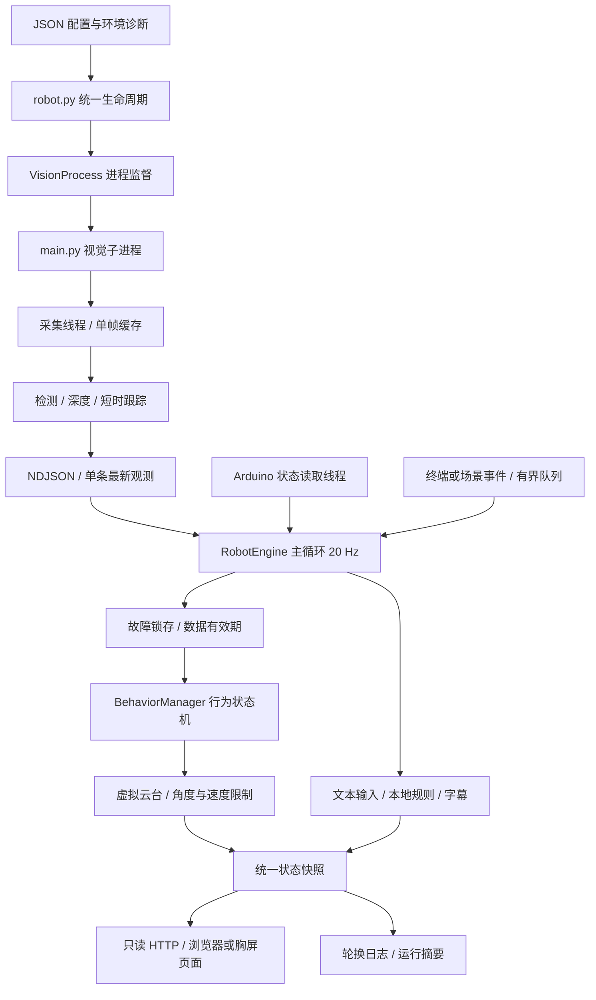

# 《靠近之前》机器人软件架构 v0.2.2

本版建立完整的运行框架，并完成可在本地验证的感知与交互闭环。架构区分输入观测、行为决策、执行意图、设备实测状态；其中**虚拟角度不是舵机实测角度**。2026-11-10 起实体保留四轮，代码移除底盘模块及轮速字段；本版状态 schema 为 2。

复核修订：退出信号处理器只设置退出标志，由正常主循环投递 shutdown；输出失败后仍回收设备/日志并恢复信号处理器；监控关闭后清除连接状态。故障注入记录见 [CODE_REVIEW.md](CODE_REVIEW.md)。

## 运行结构



选择独立视觉进程是为了让相机 SDK 和推理故障与主循环隔离。主循环不调用相机 SDK、模型推理或串口请求；它只消费最新结果并计算当前行为。实现使用 Python 标准库进程与线程，不依赖 ROS 2。后续若引入 ROS 2，可由适配层把这些契约映射到 topic/action，保留行为引擎和测试。

## 目录与职责

| 目录 / 入口 | 已实现职责 |
| --- | --- |
| `robot.py` | 统一配置、启动、固定节奏循环、信号退出、关闭资源、摘要 |
| `main.py`、`vision/` | 独立视觉 CLI，沿用 v0.1 RGB-D、检测、深度、跟踪与重连 |
| `core/config.py` | 配置合并、类型/范围校验；明确限制执行模式 |
| `core/contracts.py` | 跨进程观测校验、不可变目标/观测/命令类型 |
| `core/bus.py` | 单条最新状态、有界命令队列、HTTP 读取时的过期检查 |
| `core/vision_process.py` | 启动视觉、读取受长度限制的 JSON 行、无响应检测、有限次重启 |
| `core/engine.py` | 单步协调接口；可完全脱离设备进行确定性测试 |
| `core/inputs.py` | 控制台输入与定时场景事件 |
| `core/recording.py` | JSON 原子替换、日志轮换、每次运行的目录 |
| `behavior/behavior_manager.py` | 目标确认、关注状态、距离提示、暂停与失效处理 |
| `control/safety_manager.py` | 主程序故障锁存、Arduino 状态超时、显式复位条件 |
| `control/head_controller.py` | 图像误差驱动的虚拟云台，死区、速度与角度限幅 |
| `control/arduino_bridge.py` | 复用现有 USB 协议，仅查询状态，显式串口配置 |
| `audio/service.py` | 文本事件、确定性回复、字幕有效期；ASR/TTS 的类型接口 |
| `interface/` | 本地只读 API 和状态页面，无文件目录浏览与控制 API |
| `tests/` | 原视觉回归与架构、故障、生命周期、HTTP 集成验证 |

## 线程、频率与失效处理

| 所属 | 工作 | 默认频率 / 容量 | 失效行为 |
| --- | --- | --- | --- |
| 视觉进程采集线程 | 相机输入 | 请求 30 FPS，单帧缓存 | 清空帧，重连等待 0.5–5 秒 |
| 视觉进程主线程 | 检测与发布 | 检测目标 8 Hz，发布目标 10 Hz | 输出无效状态；不复用旧距离 |
| 主进程接收线程 | 读取视觉 NDJSON | 一条最大 256 KiB，最新观测替换 | 非法/截断数据触发进程终止与有限重启 |
| 主进程主线程 | 行为计算 | 目标 20 Hz；超时不突发追赶旧 tick | 帧过期即无目标、虚拟速度归零 |
| 主进程串口线程 | Arduino `status` | 可选 2 Hz，超时 0.3 秒 | 报错后停止请求，禁止自动重连 |
| 命令队列 | 操作与文本 | 32 条；文本最多 500 字符 | 超额丢弃计数；pause/shutdown 清除旧队列 |
| HTTP 线程 | 只读状态 | 网页约 5 Hz，单请求连接超时 2 秒 | 状态过期独立清空目标和字幕 |
| 记录器 | 状态与事件 | 状态目标 5 Hz；每文件约 2 MB + 2 个备份 | 写入失败退出；摘要记录故障 |

这些频率是调度目标，不是实时保证，尚无 Jetson 性能测量。视觉进程 15 秒无任何消息会被终止；默认最多重启 2 次，重试耗尽后主程序以错误退出。这个超时用于恢复挂住的进程；动作有效性由更短的帧龄约束控制，不会等 15 秒才使旧目标失效。

默认目标有效期为 `min(vision.max_frame_age_ms / 1000, behavior.max_target_age_s)`，即 0.5 秒。网页服务检测主循环快照超过 1 秒未更新时标记 `stale`；浏览器自身也检测请求失败和超时。故障与暂停状态不会被普通帧龄失效覆盖。

## 数据与命令契约

`vision → engine` 使用现有 v1 `perception` JSON：来源、是否合成、有效位、运行 ID、相机 generation、接收时间、人数和目标。目标中心 `center_x / center_y` 属于 `[0,1]` 图像坐标；距离是相机光轴 Z 深度，未知为 `null`。数据不完整、来自错误模式、时间过期/未来或倒退时不会进入目标控制。

`RobotEngine.step(packet, vision_health, arduino_status, commands, now)` 输出一份 JSON 可序列化状态：

```text
schema_version / run_id / updated_monotonic_s / perception_expires_at
system       status、version、mode、physical_actuation
perception   valid、reason、simulated、captured_at、source_id、target、person_count
behavior     state、reason、head_allowed
head         虚拟 pan/tilt 角度、角速度、active、physical_output=false
audio        字幕与来源；microphone/asr/tts/speech_playing 全为 false
modules      视觉子进程状态、Arduino 状态和错误
faults       当前锁存故障列表
capabilities 实际可用能力及未接通能力
```

命令支持 `pause / resume / reset / shutdown / text`。`resume / reset / text` 超过 2 秒即丢弃；延迟到达的 pause/shutdown 仍生效。已排队的 shutdown 不可被后续 pause/resume 替换，执行后也不再接受恢复动作。命令来源记录为 operator/scenario/signal。文本不直接变成电机指令。

## 行为状态

优先级为 **停止 → 故障 → 暂停 → 感知是否有效 → 当前目标状态**。

| 状态 | 进入条件 | 当前输出 |
| --- | --- | --- |
| `STARTING` | 启动宽限期内尚无有效输入 | 无目标动作 |
| `PERCEPTION_UNAVAILABLE` | 超过启动期仍无有效输入，或数据过期 | 清除目标/字幕，虚拟速度归零 |
| `IDLE` | 有效画面没有关注目标 | 虚拟云台保持当前角度 |
| `PERSON_DETECTED` | 新目标尚未完成确认 | 只显示，不驱动虚拟云台 |
| `TRACKING` | 同一目标跨新采集帧持续 0.35 秒 | 按图像误差计算虚拟角速度 |
| `KEEP_DISTANCE` | 已确认目标深度小于 0.7 m | 只给距离状态提示，不生成移动命令 |
| `PAUSED` | 操作者暂停 | 无虚拟动作、清除字幕，感知继续运行 |
| `FAULT` | 进程失败、Arduino 故障或状态超时 | 无虚拟动作；故障锁存 |
| `STOPPED` | 退出或 shutdown | 清空目标与字幕，关闭资源 |

确认计时使用**新采集帧时间**；把同一旧帧重复发布不能确认目标。目标丢失、换 ID、换相机 generation、暂停和故障都会重新开始确认。未知深度允许虚拟头部关注，但不会沿用之前距离；距离字幕在深度失效或目标变化时清除。

虚拟云台默认 pan ±35°、tilt ±20°，速度不超过 25°/s，图像误差死区 0.06。这些是软件演示坐标，不是 DS3225MG 脉宽或真实机械标定，移动虚拟角度不会改变输入画面。

## 设备边界与下一部分实现

| 模块 | 本版 | 接入真实能力的下一步 |
| --- | --- | --- |
| 感知 | RGB-D、HOG、跟踪、深度；可选本地 YOLO 接口 | Jetson SDK/USB 实测，明确半身检测和多人交叉性能 |
| 底层通信 | head-1 状态查询、独立监控 | 完成固件实机验证与标定后，新增独立执行适配器 |
| 头部 | 虚拟比例速度控制 | 明确舵机轴、方向、机械限位、零点和脉宽映射；设计动作租约 |
| 四轮实体 | 保留结构，软件无底盘模块 | 不纳入本轮软件开发与评价 |
| 语音 | 可测试的文本→回复→字幕，`SpeechRecognizer`/`SpeechOutput` 协议 | 录音设备、VAD/ASR、打断/取消、TTS 播放，先测试资源占用 |
| 对话 | 基于当前有效视觉的少量本地规则 | 按作品交互脚本加入更丰富状态；如接 LLM，隔离动作权限 |
| 胸屏 | 浏览器状态页可用于原型显示 | 确认手机/屏幕接入方式，再制作面向观众的交互画面 |
| 导航 | 不纳入本轮范围 | 不作为待开发任务或研究指标 |

真实执行不能只修改 `control.mode` 就启用，本版会拒绝该配置。未来执行适配器必须单独拥有串口，并结合现有 session、arm_epoch、心跳与舵机限位；监控器和执行器不能分别打开同一端口。需要实测后再实现动作错误和重连时的行为。当前硬件没有软件动力切断能力，软件 API 不应伪造 `physical_stop_confirmed=true`。

## 参考

本版进程与线程生命周期基于 Python 官方 [subprocess](https://docs.python.org/3/library/subprocess.html)；状态页使用 [http.server](https://docs.python.org/3/library/http.server.html)，定位为本地开发服务。视觉 SDK、检测算法及部署依据沿用[视觉说明](README.md)中的官方资料。
